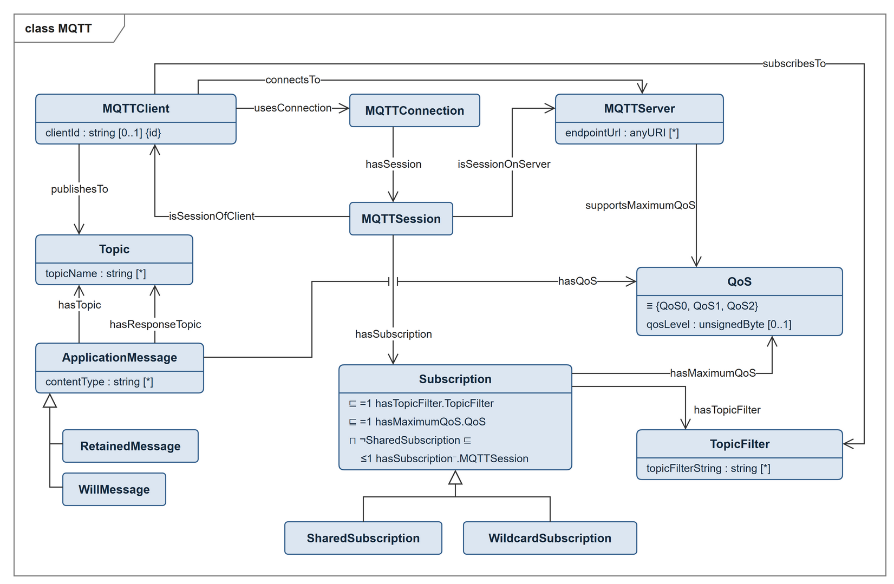

# MQTT Ontology-Design-Pattern

## Introduction

Applications that monitor, analyze or coordinate distributed devices need to know
how those devices talk to each other. In robotics and manufacturing, a large part
of that traffic is publish/subscribe: a device publishes application messages
under a topic, and other devices subscribe to the topics they are interested in.
The protocol that does this in most systems is MQTT. Describing the communication
means of a system together with the rest of its model — its structure, its
capabilities, its skills — requires the vocabulary of that protocol in the same
schema as everything else.

This repository contains an ontology of MQTT, which is an OASIS standard for a
publish/subscribe messaging transport. We maintain a whole list of
standard-based ontologies, check out these links:
 - [DIN EN 61360](https://github.com/hsu-aut/IndustrialStandard-ODP-DINEN61360)
 - [VDI 2206](https://github.com/hsu-aut/IndustrialStandard-ODP-VDI2206)
 - [VDI 2860](https://github.com/hsu-aut/IndustrialStandard-ODP-VDI2860)
 - [VDI 3682](https://github.com/hsu-aut/IndustrialStandard-ODP-VDI3682)
 - [DIN 8580](https://github.com/hsu-aut/IndustrialStandard-ODP-DIN8580)
 - [ISA 88](https://github.com/hsu-aut/IndustrialStandard-ODP-ISA88)
 - [WADL](https://github.com/hsu-aut/IndustrialStandard-ODP-WADL)
 - [DIN EN 62264-2](https://github.com/hsu-aut/IndustrialStandard-ODP-DINEN62264-2)
 - [OPC UA](https://github.com/hsu-aut/IndustrialStandard-ODP-OPC-UA)
 - [ISO 22400-2](https://github.com/hsu-aut/IndustrialStandard-ODP-ISO22400-2)
 - [IEEE 1872.2](https://github.com/hsu-aut/IndustrialStandard-ODP-IEEE1872-2)
 - [VDI 5100](https://github.com/hsu-aut/IndustrialStandard-ODP-VDI5100)

## MQTT

The ontology follows *MQTT Version 5.0*, OASIS Standard, 07 March 2019 [1].
Every entity carries an `rdfs:label`, an `rdfs:comment` and a `dcterms:source`
annotation naming the clause of the standard it reflects.

**Clients, servers, sessions and connections.** A `MQTTClient` has a
`clientId`, which identifies it uniquely (clause 3.1.3.1), and uses a
`MQTTConnection`. A `MQTTSession` is the stateful interaction between a client
and a server (`isSessionOfClient`, `isSessionOnServer`); it can span several
consecutive connections, each of which `hasSession`. `connectsTo` relates a client to the
server it talks to and follows from the session or the connection by property
chains. A `MQTTServer` is reached at an `endpointUrl` and
declares what it supports: maximum QoS, retained messages, wildcard
subscriptions, shared subscriptions and subscription identifiers.

**Topics and subscriptions.** A client `publishesTo` a `Topic`. An
`ApplicationMessage` has one `Topic` with a `topicName` and may name a response
topic (`hasResponseTopic`); `RetainedMessage` and `WillMessage` are kinds of
application message. A session `hasSubscription`; a `Subscription` has one
`TopicFilter` with a `topicFilterString` and one maximum QoS, and unless it is
shared it belongs to at most one session (clause 1.2). `subscribesTo` relates a
client to a topic filter and follows from its sessions' subscriptions by a
property chain. `SharedSubscription` and `WildcardSubscription` are kinds of subscription, and
a subscription carries its options: `noLocal`, `retainAsPublished` and a
`RetainHandling` value.

**Control packets.** All fifteen packet types of clause 2.1.2 are subclasses of
`MQTTControlPacket`, pairwise disjoint and annotated with their wire value from
Table 2-1. A packet has a `FixedHeader`, a `VariableHeader` and, depending on
its type, a `Payload` — required for CONNECT, SUBSCRIBE, SUBACK, UNSUBSCRIBE and
UNSUBACK, optional for PUBLISH, absent from the other nine (Table 2-5). A
PUBLISH carries its application message, SUBSCRIBE and UNSUBSCRIBE their topic
filters, and the acknowledgements their reason codes.

**Quality of service.** `QoS` is the enumeration of `QoS0`, `QoS1` and `QoS2`
(clause 4.3). `hasQoS` gives the level of an application message,
`hasMaximumQoS` the highest level a server may use for a subscription. The
classes `QoS0Publication`, `QoS1Publication` and `QoS2Publication` are defined
over the level of the carried message, so a reasoner derives them from the data.

**Properties.** All 27 property identifiers of Table 2-4 (clause 2.2.2.2) are
covered. Each one is modelled on the entity it is about — the session, the
message, the subscription, the server — except for those that appear in several
packet types and belong to the packet itself; those are reached through
`hasProperty`. A `UserProperty` is a name-value pair (`propertyName`,
`propertyValue`), and `PayloadFormat` is the enumeration of the two values of
clause 3.3.2.3.2.

**Reason codes.** All 45 reason codes of Table 2-6 (clause 2.4) are individuals
of the enumerated class `ReasonCode`, each with its `reasonCodeValue` and the
packet types it may appear in. `SuccessReasonCode` and `ErrorReasonCode` are
defined over that value, since clause 2.4 draws the line at 0x80, so a reasoner
derives which code is which. `hasReasonCode` relates a packet to its code, at
most one for the packets that carry a single code and a list for SUBACK and
UNSUBACK.

The ontology is OWL 2 DL and consistent under HermiT.

## Class diagram

The diagram shows the communication core: clients, connections, sessions,
servers, subscriptions, topics, topic filters, application messages and QoS.
Arrows point from the domain to the range of a property; hollow triangles
denote subclass relations. Class axioms are listed
inside the boxes in description logic notation; `{id}` marks the key
`clientId`. Not shown: the control packets with their headers, payloads,
properties and reason codes, `PayloadFormat`, `RetainHandling` and most data
properties.

<p align="center">

</p>

The editable source is [`pictures/mqtt.drawio`](pictures/mqtt.drawio) (open with [draw.io](https://www.drawio.com)).

## Constraints

Three statements of the standard are string patterns and one is a key
constraint, which OWL 2 cannot express. They are available as SHACL shapes in
`constraints/mqtt-shapes.ttl`: no wildcards in a topic name (clause 4.7.1), a
different topic filter per subscription within a session (clause 1.2), the
`$share/{ShareName}/{filter}` form of a shared subscription's topic filter
(clause 4.8.2), and a reason code only in the packet types Table 2-6 lists for
it (clause 2.4). Validate your data together with `mqtt.ttl`, because the last
shape reads the annotations of the ontology.

```sh
uv run tools/check_shapes.py
```

The script checks the shapes against the fixtures in `tests/fixtures/`. Without
[uv](https://docs.astral.sh/uv/), install `requirements.txt` into a virtual
environment and run it with that interpreter.

## Usage

If you want to use this ontology design pattern, the easiest way is to import it
into your ontology via an `owl:imports` statement. Reference a fixed release
version so that future changes cannot surprise you:

```turtle
<http://example.org/my-ontology#> rdf:type owl:Ontology ;
    owl:imports <https://raw.githubusercontent.com/hsu-aut/IndustrialStandard-ODP-MQTT/v6.0.1/mqtt.ttl> .
```

The ontology IRI is `http://www.w3id.org/hsu-aut/MQTT`, version IRIs are of the
form `http://www.w3id.org/hsu-aut/MQTT/6.0.1`.

Of course you can also clone this repository and import a local copy.

[1] A. Banks, E. Briggs, K. Borgendale, R. Gupta (eds.): *MQTT Version 5.0*.
OASIS Standard, 07 March 2019.
https://docs.oasis-open.org/mqtt/mqtt/v5.0/os/mqtt-v5.0-os.html
